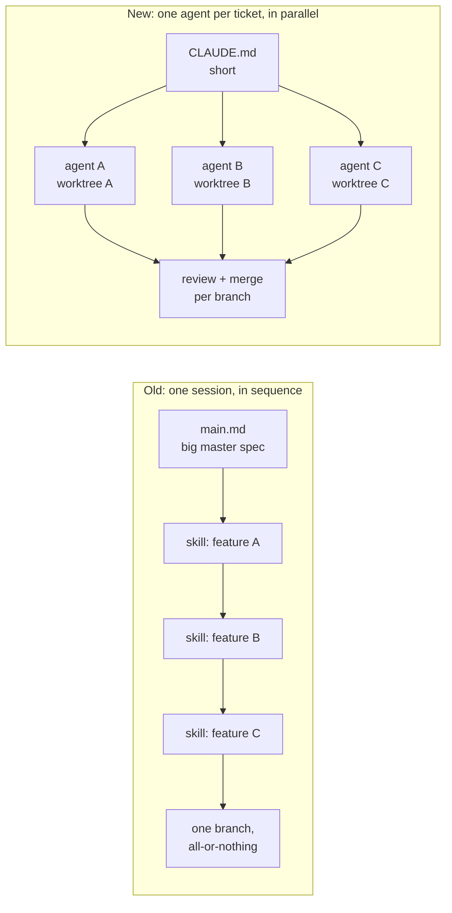
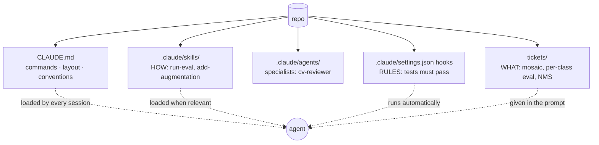
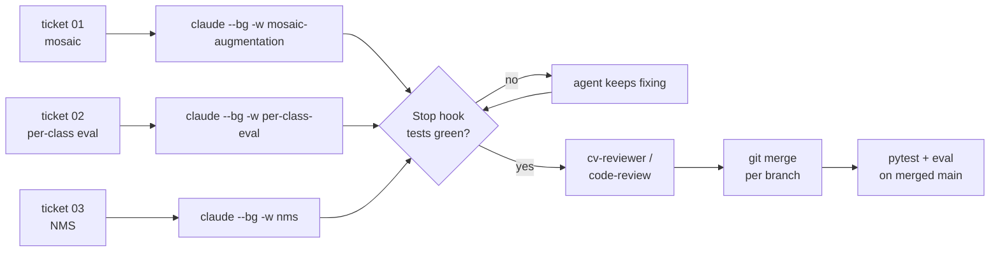
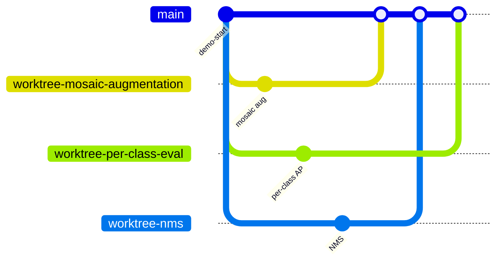
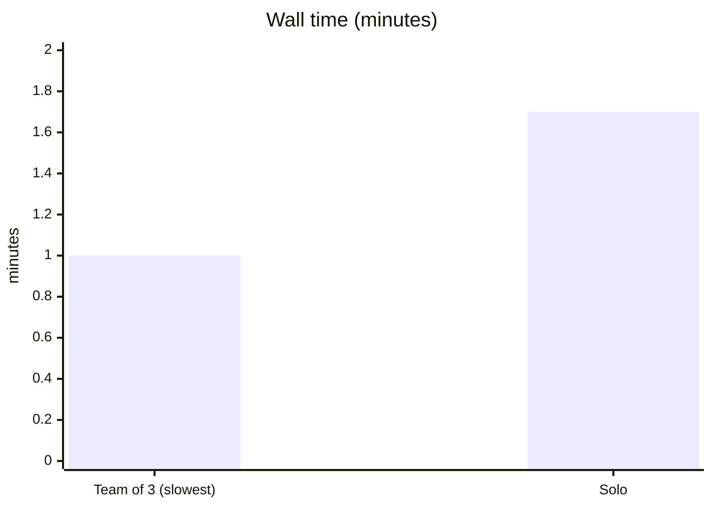
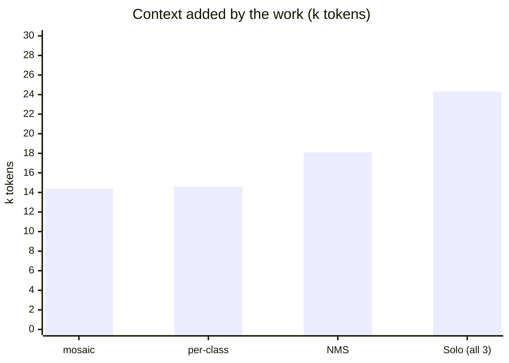
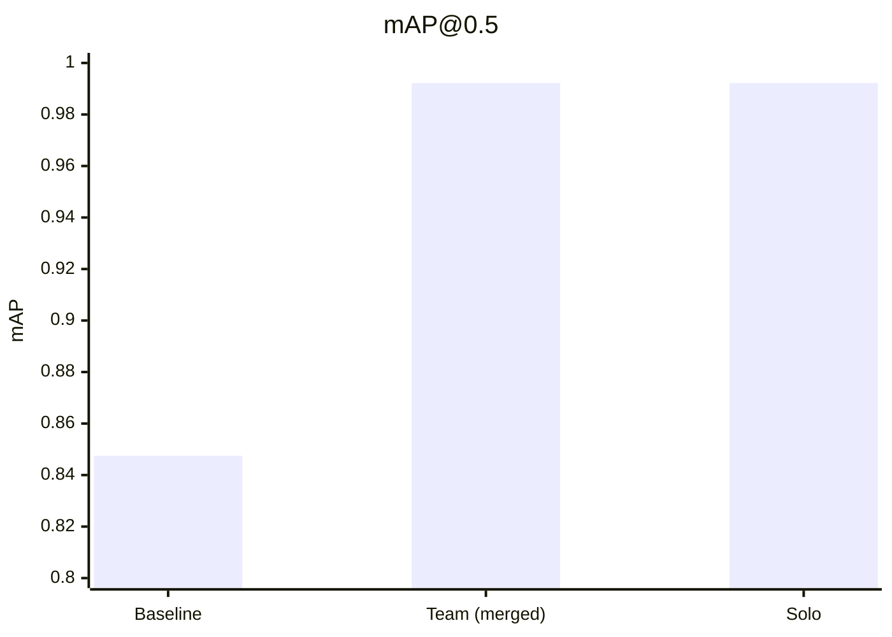
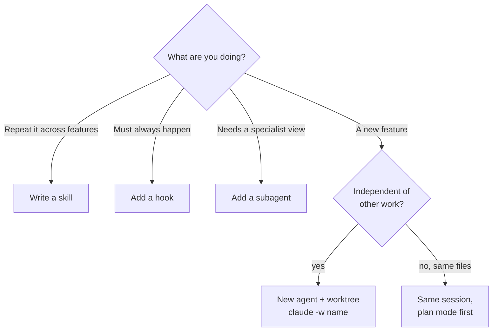

# Parallel Claude agents for CV work

One repo, one agent per feature, each in its own worktree. Skills say **how** we work, tickets say **what** to build.

---

## 1. Old way vs new way



| | Old | New |
|---|---|---|
| Spec | One big master file | Short `CLAUDE.md` + one ticket per feature |
| Skills | One per feature | One per **repeatable procedure** |
| Execution | One session, one feature after another | N sessions, each in its own worktree |
| Rules | "Please run tests" in a prompt | A **hook** enforces it |

---

## 2. What goes where



| Piece | Lives for | Example |
|---|---|---|
| `CLAUDE.md` | Life of the repo | `python3 -m detector.eval` prints mAP |
| Skill | Life of the repo | "Mosaic/crop must clip boxes and drop labels too" |
| Subagent | Life of the repo | `cv-reviewer` checks box/pixel geometry and NMS bugs |
| Hook | Life of the repo | Stop hook: can't finish while pytest is red |
| Ticket | One feature | `tickets/03-nms.md` |

---

## 3. The workflow



```bash
./scripts/launch-agents.sh            # 3 background agents, 3 worktrees
claude agents                         # watch them
claude attach nms                     # jump in
git merge worktree-nms                # merge one feature at a time
```

**Isolation:** each agent edits its own copy of the repo on its own branch. Overlaps (here, `eval.py`) only meet at merge time.



---

## 4. Results: team of 3 vs one solo agent

Same 3 tickets, all four agents started at the same moment (`./scripts/race.sh`).

**Timeline (seconds).** Total time is the slowest ticket, not the sum:

```mermaid
gantt
  title Wall-clock time (approx., from 0.7 / 0.8 / 1.0 / 1.7 min)
  dateFormat X
  axisFormat %M:%S
  section Team of 3
  mosaic          :0, 42
  per-class eval  :0, 48
  NMS             :0, 60
  section Solo
  all 3 tickets in sequence :0, 102
```





**Context.** Every agent starts at about 41k tokens. This is what each one added while working:



**Outcome.** Same quality on the merged result:



| | Team of 3 | Solo |
|---|---|---|
| Wall time | **1.0 min** | 1.7 min |
| Peak context per agent | 56–59k | 65k |
| Output tokens | 25.6k | **20.3k** |
| Tests / mAP | 17 / 0.9922 | 17 / 0.9922 |
| Revert one feature | One branch | Pick it out of a single branch |

**Takeaway:** parallel buys **wall-clock time** and **smaller, focused context** for about 25% more output tokens.
On toy tickets that's 1.7×; for N independent features the time gets closer to N×.

---

## 5. When to use what



## Rules of thumb

1. Keep `CLAUDE.md` short. Every session pays for it.
2. A skill is a procedure, not a feature.
3. One feature → one agent → one worktree → one branch.
4. Split tickets along module boundaries (`transforms.py`, `metrics.py`, `postprocess.py`) to avoid conflicts.
5. Hooks enforce rules, prompts only suggest them.
6. A clean merge isn't proof. Run tests and eval on the merged result.
